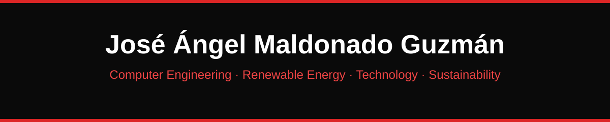

  

  

  
  
  

  

<h2 align="center">About Me</h2>

  

  

  Hey! I'm <b>José Ángel Maldonado Guzmán</b>, a <b>Computer Engineering</b> student at
  <b>UAEMéx</b> and also a <b>Renewable Energy Engineering</b> student at <b>UnADM</b>.
    
  I'm interested in combining <b>software development, artificial intelligence,
  data, renewable energy and environmental technology</b> to create practical solutions.

  
  
  
  

<h2 align="center">🎓 Academic Background</h2>

  <b>UAEMéx</b> — Computer Engineering (Ingeniería en Computación) 
  <b>UnADM</b> — Renewable Energy Engineering (Ingeniería en Energías Renovables)

<table width="100%" border="0" align="center">
  <tr>
    <td width="50%" align="center" style="padding:14px;">
      <h4>💻 Software</h4>
      

        <b>Development & Systems</b> 
        Programming, databases and application development
      

    </td>
    <td width="50%" align="center" style="padding:14px;">
      <h4>🤖 Artificial Intelligence</h4>
      

        <b>AI & Data</b> 
        Data analysis, automation and intelligent solutions
      

    </td>
  </tr>
  <tr>
    <td width="50%" align="center" style="padding:14px;">
      <h4>🌱 Sustainability</h4>
      

        <b>Environmental Technology</b> 
        Biodiversity, climate and environmental projects
      

    </td>
    <td width="50%" align="center" style="padding:14px;">
      <h4>⚡ Energy</h4>
      

        <b>Renewable Energy</b> 
        Technology applied to sustainable energy solutions
      

    </td>
  </tr>
</table>

<h2 align="center">🚀 Featured Projects</h2>

<table width="100%" border="0" align="center">
  <tr>
    <td align="center" style="padding:22px;">
      <h3>🏥 ASMI</h3>
      

        Multihospital healthcare management system focused on improving
        patient information, medical staff management and hospital workflows.
      

      

        <b>Focus:</b> Software · Databases · Systems · Healthcare · Automation
      

    </td>
  </tr>
</table>

<h2 align="center">📚 Publications</h2>

  Science communication articles published on blogs in <b>9 countries</b> — Japan, South Korea,
  France, Ecuador, Thailand and more — about technology, sustainability, data and law. 
  36 textos de divulgación publicados · ORCID:
  <a href="https://orcid.org/0009-0005-7538-3768">0009-0005-7538-3768</a>

<h3>🌎 Around the World</h3>

- 🇯🇵 **note (Japan)** — [Pagos digitales en India: el sistema UPI](https://note.com/jose_a_maldonado/n/n4d7604cfad76) · [The Right to Repair](https://note.com/jose_a_maldonado/n/n0d54d74035d7) · [ペロブスカイト太陽電池](https://note.com/jose_a_maldonado/n/n4607cd8ddb39)
- 🇰🇷 **Velog (South Korea)** — [멕시코의 반도체: 칩을 만들기 위해 무엇이 부족한가](https://velog.io/@jose-a-maldonado/멕시코의-반도체-칩을-만들기-위해-무엇이-부족한가)
- 🇰🇷 **Tistory (South Korea)** — [전기차 배터리는 죽지 않는다: 폐배터리의 두 번째 인생](https://joseangelmaldonado.tistory.com/1)
- 🇫🇷 **OverBlog (France)** — [La Ley de Inteligencia Artificial de la Unión Europea explicada](https://ciencia-y-tecnologia-con-jose-maldonado.overblog.fr/2026/11/la-ley-de-inteligencia-artificial-de-la-union-europea-explicada.html)
- 🇫🇷 **Canalblog (France)** — [Comunidades energéticas: cuando los vecinos producen su propia electricidad](https://cienciaytecnologia.canalblog.com/2026/11/comunidades-energeticas-cuando-los-vecinos-producen-su-propia-electricidad.html)
- 🇪🇨 **Inkspired (Ecuador)** — [El Acuerdo de Escazú: justicia ambiental en América Latina](https://getinkspired.com/es/story/766794/el-acuerdo-de-escazu-justicia-ambiental-en-america-latina-explicado/)
- 🇹🇭 **Blockdit (Thailand)** — [การจดจำใบหน้าในพื้นที่สาธารณะ](https://www.blockdit.com/posts/6af8b15f13407895884d33ed)
- 🇹🇭 **Pantip (Thailand)** — [ขยะอวกาศ: กองขยะที่ใหญ่ที่สุดของมนุษยชาติ](https://pantip.com/topic/44286036)

<h3>📝 DEV.to</h3>

- [Cómo funciona el GPS: satélites, relojes y un poco de Einstein](https://dev.to/joseangelmaldonado/como-funciona-el-gps-satelites-relojes-y-un-poco-de-einstein-4hk3)
- [Tu contraseña es débil: ataques de fuerza bruta](https://dev.to/joseangelmaldonado/tu-contrasena-es-debil-como-funciona-un-ataque-de-fuerza-bruta-y-como-defenderte-db6)
- [Qué es una API: el mesero que conecta todo el software](https://dev.to/joseangelmaldonado/que-es-una-api-el-mesero-que-conecta-todo-el-software-2fm7)
- [Así aprende una IA: datos, ejemplos y mucha paciencia](https://dev.to/joseangelmaldonado/asi-aprende-una-ia-datos-ejemplos-y-mucha-paciencia-356)
- [El botón de aceptar cookies: qué estás aceptando en realidad](https://dev.to/joseangelmaldonado/el-boton-de-aceptar-cookies-que-estas-aceptando-en-realidad-1b0n)
- [Copia de seguridad 3-2-1](https://dev.to/joseangelmaldonado/copia-de-seguridad-3-2-1-la-regla-que-salva-tesis-fotos-y-negocios-1986)

<h3>📝 Hashnode</h3>

- [La nube tiene sed: cuánta agua gastan los centros de datos](https://joseangelmaldonado.hashnode.dev/la-nube-tiene-sed-cu-nta-agua-gastan-los-centros-de-datos-que-guardan-tus-fotos)
- [Paneles solares en el techo: cuánta energía produce una casa al año](https://joseangelmaldonado.hashnode.dev/paneles-solares-en-el-techo-cu-nta-energ-a-produce-una-casa-al-a-o)
- [La basura electrónica de tu cajón](https://joseangelmaldonado.hashnode.dev/la-basura-electr-nica-de-tu-caj-n-a-d-nde-van-los-celulares-que-ya-no-usas)

<h3>📝 Telegraph</h3>

- [El sesgo está en los datos](https://telegra.ph/El-sesgo-est%C3%A1-en-los-datos-cuando-un-algoritmo-aprende-nuestros-prejuicios-11-13)
- [La tecnología llega a los tribunales](https://telegra.ph/La-tecnolog%C3%ADa-llega-a-los-tribunales-expedientes-electr%C3%B3nicos-audiencias-por-video-y-jueces-con-algoritmo-11-13)
- [Energía eólica sin mitos](https://telegra.ph/Energ%C3%ADa-e%C3%B3lica-sin-mitos-el-viento-tambi%C3%A9n-trabaja-de-noche-11-13)
- [Lo que tu cerebro hace mientras duermes: la ciencia del sueño](https://telegra.ph/Lo-que-tu-cerebro-hace-mientras-duermes-la-ciencia-del-sue%C3%B1o-11-13)
- [El correo electrónico, el abuelo de internet](https://telegra.ph/El-correo-electr%C3%B3nico-el-abuelo-de-internet-que-se-niega-a-morir-11-13)
- [El telescopio en tu bolsillo: astronomía con un celular](https://telegra.ph/El-telescopio-en-tu-bolsillo-astronom%C3%ADa-con-un-celular-11-13)
- [Leer código, el idioma secreto que mueve tu día](https://telegra.ph/Leer-c%C3%B3digo-el-idioma-secreto-que-mueve-tu-d%C3%ADa-11-13)
- [Gráficas que mienten: cómo detectar una estadística manipulada](https://telegra.ph/Gráficas-que-mienten-cómo-detectar-una-estadística-manipulada-11-13)

<h3>📝 Write.as</h3>

- [Derecho de autor e inteligencia artificial](https://write.as/a0sp2qamo0ung.md)
- [Tu huella digital](https://write.as/22cc9505ygeod.md)
- [La paradoja de los cumpleaños](https://write.as/2nu3p4w2y5o40.md)
- [El tráfico y los datos](https://write.as/idn34ybyxozgu.md)
- [El viaje de una botella](https://write.as/zfl2782nfmf56.md)
- [Agua con datos: riego inteligente](https://write.as/2zllkd5zxnovg.md)
- [Software libre](https://write.as/q0igle3u0be1k.md)
- [Las matemáticas del supermercado](https://write.as/t8ie3wx3pav7v.md)
- [La ciencia se corrige a sí misma](https://write.as/9m5h9g1cg43t6.md)

<h2 align="center">🛠️ Tech Stack</h2>

  <b>Programming Languages</b>

  

  <b>Frontend & Mobile</b>

  

  <b>Backend & Databases</b>

  

  <b>Tools & Technologies</b>

  

  
  
  
  
  

<h2 align="center">🌎 Areas of Interest</h2>

  
  
  
  
  
  

<h2 align="center">📊 GitHub Analytics</h2>

  

  

  

<h2 align="center">🐍 Contribution Journey</h2>

  

<h2 align="center">🌐 Let's Connect</h2>

  <i>Technology, software, AI, sustainability, renewable energy and new ideas.</i>

  
  
  

  <b>José Ángel Maldonado Guzmán</b> 
  Computer Engineering · Renewable Energy · Technology · Sustainability

  

